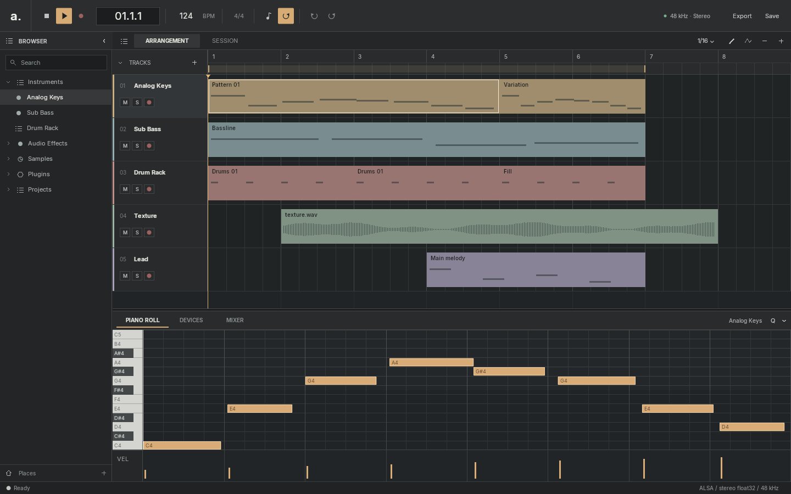

# Ally — DAW 개발 기반

C++23으로 만드는 Linux·Windows·macOS 데스크톱 전용 전문 DAW의 첫 구현입니다. 프로젝트 이름은 **Ally**입니다. 프로젝트 오픈소스 라이선스는 미정입니다. 아직 전문 DAW의 전체 기능을 제공하는 제품은 아닙니다.

개발 저장소: [wavefnd-labs/ally](https://github.com/wavefnd-labs/ally). 저장소의 접근 공개 여부와 오픈소스 배포 라이선스는 별도로 관리합니다.

## 현재 동작하는 경로

사용자 제공 Studio 04 HTML을 시각적 명세로 사용한 SDL3·Skia 네이티브 작업 공간입니다. 이전 UI 디자인은 제거했습니다. [디자인 원본 사본](assets/design/ally-ui-studio-04.html)은 참고 자료이며 앱이 HTML/JavaScript를 실행하지 않습니다. 최소화·최대화·닫기는 OS 제목 표시줄을 사용합니다.

기본 화면은 5트랙, 8마디 Arrangement, Piano Roll / Devices / Mixer 도크입니다. 채널별 4-beat 패턴을 자유 길이 MIDI 클립으로 반복 배치하며 자체 64보이스 신스로 재생합니다. Texture 클립은 프로그램에서 생성한 2초 stereo PCM을 반복 재생하며 그 PCM의 파형을 표시합니다. 임의 오디오 파일 import/streaming은 아직 지원하지 않습니다. Linux ALSA 출력과 PCM16 WAV export가 동작합니다.

최대 8트랙, 512 prepared note events, 32 PCM 클립입니다. 문서 버전 4에 클립 위치·길이, mixer/device 상태와 loop/metronome을 저장하고 버전 1–3을 읽습니다. 노트는 MIDI 0–127, 템포는 20–300 BPM입니다. 기본 재생은 HTML의 loop 영역처럼 1–6마디를 반복하며 loop를 끄면 8마디 끝에서 정지합니다. Export는 8마디 전체를 렌더링합니다.



[Devices](docs/images/devices.png) · [Mixer](docs/images/mixer.png)

## Linux 빌드

Python 3.12 이상(표준 라이브러리만 사용), CMake 3.25 이상, Ninja, Clang/Clang++ 16 이상, Git, pkg-config, ALSA/OpenGL/FreeType/fontconfig 개발 패키지가 필요합니다. SDL3 빌드에 필요한 X11/Wayland/EGL 개발 패키지는 사용 환경에 맞게 설치합니다. 네이티브 Wayland 제목 표시줄에는 libdecor 개발 파일도 필요합니다. 없으면 X11/XWayland를 우선해 OS 창 장식을 사용합니다. 첫 다운로드에는 인터넷이 필요하며 이후 로컬 의존성으로 빌드할 수 있습니다.

```bash
python3 x.py doctor
python3 x.py deps
python3 x.py build
python3 x.py run
python3 x.py test
python3 x.py fmt --check
python3 x.py clean
python3 x.py build --release
python3 x.py package --release
```

Skia 공식 소스의 고정 커밋과 upstream GN으로 라이브러리를 만들고, CMake 타깃에서 연결합니다. GN은 Skia의 자체 빌드 도구이며 DAW/오디오/미디어 빌드는 CMake가 담당합니다. 소스 및 라이브러리는 `third_party/`에 생성되고 제품 소스와 구분됩니다. PFFFT/Highway/libsoxr는 아직 사용하는 DSP가 없어 연결하지 않습니다.

CMake 단독 실행도 가능합니다.

```bash
cmake --preset debug
cmake --build --preset debug
ctest --preset debug
./build/debug/ally
```

의존성을 먼저 준비해야 합니다. 시스템 SDL3가 있더라도 초기 검증은 고정 소스 버전을 사용합니다. Windows/macOS에서는 CMake 단독 구성에 해당 플랫폼용 동일 Skia 소스/라이브러리를 지정합니다. Linux용 GN 자동 빌드와 Clang 프리셋은 Windows 빌드를 대신하지 않습니다.

```bash
cmake -S . -B build/native -G Ninja -DCMAKE_BUILD_TYPE=Debug \
    -DSKIA_ROOT=/path/to/skia -DSKIA_LIBRARY=/path/to/libskia.a
cmake --build build/native
```

Windows는 호환 MSVC/clang-cl ABI와 `.lib` 경로가 필요합니다. macOS는 CoreText font manager와 GL Ganesh가 포함되어야 합니다. 두 플랫폼의 빌드/실행은 현재 Linux 환경에서 검증하지 않았으며 네이티브 오디오 출력은 명시적으로 미지원입니다. 오프라인 렌더링 코어는 플랫폼 UI에 의존하지 않습니다.

## 독립 모듈 빌드

```bash
cmake -S libs/audio -B build/audio -G Ninja
cmake --build build/audio
ctest --test-dir build/audio --output-on-failure
cmake -S libs/media -B build/media -G Ninja
cmake --build build/media
ctest --test-dir build/media --output-on-failure
```

오디오 모듈은 미디어/SDL/Skia/libremidi 없이 빌드됩니다. ALSA 없는 코어 빌드는 `-DALLY_AUDIO_ALSA=OFF`로 구성하며 I/O 미지원 상태를 반환합니다. 미디어 모듈은 외부 의존성이 없습니다.

## 조작

- Space: 재생/일시정지, Escape: 정지 후 처음으로 이동. 타임라인 룰러 클릭: seek.
- 피아노 롤 클릭: snap 위치에 노트 추가. 드래그: 이동. 오른쪽 끝 드래그: 길이 변경. 오른쪽 클릭: 삭제. velocity 막대 클릭: 세기 변경. Q: quantize.
- 건반을 누르는 동안 선택 채널의 신스를 미리 듣습니다. Ctrl+휠: 음역 이동, 휠: 시간 확대, Shift+휠: 시간축 이동.
- 트랙 제목/브라우저 악기 클릭: 채널 선택. Arrangement 빈 곳 클릭: 4-beat 클립 추가. 클립 드래그/끝 드래그/오른쪽 클릭: 이동/길이 변경/삭제. 추가 버튼은 최대 8채널까지 지원합니다. 트랙 영역 휠: 세로 스크롤.
- F5: Piano Roll, F9: Mixer, F8: 브라우저 표시 전환. 도크 탭: Piano Roll / Devices / Mixer. 분할선 드래그 또는 접기 버튼으로 높이를 바꿉니다.
- Mixer: 채널·Master fader와 mute, 채널 solo, 실제 peak. 휠로 strip을 가로 스크롤합니다. Devices: Cutoff 노브를 수직으로 드래그합니다.
- BPM 클릭 후 숫자 입력·Enter로 적용, Escape 취소. 브라우저 Search에 입력해 목록을 필터링합니다. Snap 1/16·1/8, +/- 확대, loop/metronome 버튼을 지원합니다.
- Ctrl+Z: Undo, Ctrl+Shift+Z 또는 Ctrl+Y: Redo. 최대 64개 문서 변경 이력.
- Ctrl+S/Save: 현재 디렉터리 `session.ally` 저장. Ctrl+O/Projects: 해당 파일 복원. Ctrl+E/Export: `render.wav`에 48 kHz stereo PCM16 출력.

저장/내보내기 대상은 현재 고정 파일명이며 같은 이름을 사용합니다. Windows의 기존 프로젝트 파일 원자적 교체는 아직 지원되지 않아 실패를 표시합니다. 파일 선택기, 자동 저장, 다중 선택/복사와 범용 편집 command 시스템은 다음 단계입니다. 파일 작업은 UI 스레드에서 실행되어 큰 작업의 진행 UI/worker 처리가 필요합니다.

```bash
./build/debug/ally --render /tmp/pattern.wav
./build/debug/ally --inspect /tmp/pattern.wav
./build/debug/ally --project session.ally --render /tmp/session.wav
./build/debug/ally --offline
./build/debug/ally --view mixer
SDL_VIDEODRIVER=offscreen ./build/debug/ally --smoke --screenshot /tmp/workspace.bmp
```

`--offline`은 장치 없이 재생 위치를 시뮬레이션하며 소리가 나지 않습니다. GUI도 SDL3/Skia GL로 렌더링합니다. 오디오 장치 개방 실패 시 오류를 표시하고 이 모드로 작동합니다. `--smoke`는 실제 렌더된 hit target으로 노트·velocity·클립 편집, Undo/Redo, 채널·Master fader, cutoff, mute/solo, BPM 입력, 검색, 채널 추가, loop/metronome과 SDL 키보드 재생을 검사합니다. EGL/OpenGL 드라이버가 없는 환경에서는 실패합니다.

## 품질과 상태

`docs/VALIDATION.md`에 실제 검증 결과를 기록합니다. ASan/UBSan은 `cmake --preset asan`으로 구성합니다. ptrace 제한 환경에서 LeakSanitizer가 실패하면 `ASAN_OPTIONS=detect_leaks=0 ctest --preset asan`을 사용하며 누수 검증으로 해석하지 않습니다.

RF64/AIFF, 스트리밍, 녹음, 임의 오디오 파일 import, 플러그인, 자동화, Session/클립 런처, Res/Drive/EQ/Reverb, 범용 도킹은 미구현입니다. UI에서 지원하지 않는 조작은 미지원 상태를 표시합니다. libremidi는 첫 MIDI 입력 포트를 열어 Note On/Off를 연결하지만 MIDI 기록/샘플 정확한 라이브 타임스탬프 보정은 아직 없습니다. Launchpad Mk2/RC-505 실제 기기는 검증하지 않았습니다.

기술 근거와 각 라이브러리 라이선스는 [의존성 문서](docs/DEPENDENCIES.md), 구조는 [아키텍처](docs/ARCHITECTURE.md)를 참고합니다. 배포 라이선스는 결정 전이며 로컬 패키지 생성은 공개 배포 승인이나 라이선스 확정을 의미하지 않습니다.

현재 환경에서 실제 NVIDIA RTX 2060 GL 렌더링과 ALSA 출력, Debug/Release·ASan/UBSan/LeakSanitizer 코어 검사를 통과했습니다. [화면 캡처](docs/images/workspace.png)는 실제 애플리케이션 GPU surface에서 추출한 이미지입니다.
